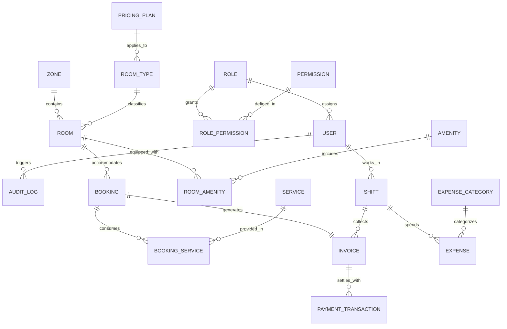
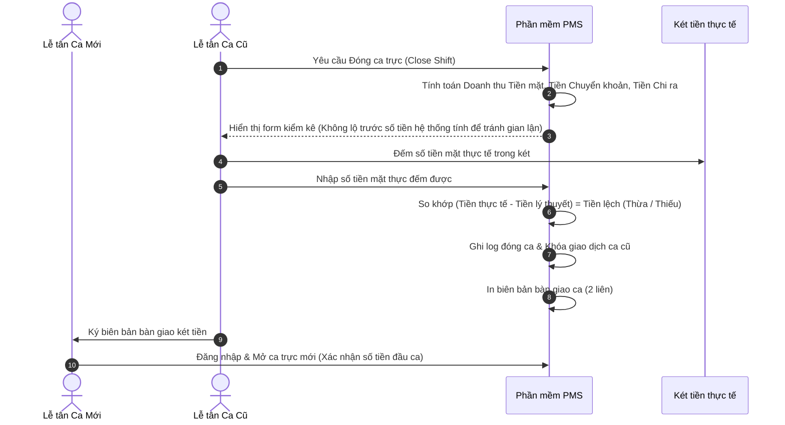

# TÀI LIỆU KIẾN TRÚC HỆ THỐNG QUẢN LÝ NHÀ NGHỈ / KHÁCH SẠN (DESKTOP WINDOWS)

---

## 1. NHẬN ĐỊNH NGHIỆP VỤ & THÁCH THỨC ĐẶC THÙ (DOMAIN INSIGHTS)

Trước khi viết bất kỳ dòng mã nào, hệ thống quản lý nhà nghỉ / khách sạn (PMS - Property Management System) trên máy tính để bàn (Windows Desktop) cần giải quyết các bài toán "sống còn" sau:

### 1.1. Bài toán Đăng nhập, Phân quyền & Chống gian lận (RBAC & Audit Logging)
Trong khách sạn/nhà nghỉ, thất thoát tài chính và gian lận thường xuất phát từ quầy lễ tân:
- Nhân viên tự ý đổi giá phòng cho khách quen rồi bỏ túi tiền chênh lệch.
- Khách đã nhận phòng nhưng hủy trên phần mềm để chiếm đoạt tiền giờ của khách.
- Thu tiền mặt nhưng không xuất bill hoặc in bill tạm rồi xóa.
- Xem lén các báo cáo tài chính nhạy cảm của chủ kinh doanh.

> [!IMPORTANT]
> **Giải pháp kiến trúc**: Thiết kế hệ thống **Phân quyền dựa trên vai trò (RBAC - Role-Based Access Control)** chặt chẽ đến từng hành động, kết hợp với cơ chế **Audit Log bất biến (Append-only Audit Trail)** ghi nhận mọi thao tác nhạy cảm (Sửa giá, Giảm giá, Hủy phòng, Đổi phòng, Mở ngăn kéo tiền không bill).

---

### 1.2. Đơn giá Động & Tùy biến Phòng không fix cứng (Zero-Hardcoding Principle)
Mỗi cơ sở lưu trú có mô hình kinh doanh và cơ cấu phòng hoàn toàn khác nhau:
1. **Đơn giá linh hoạt (Dynamic Pricing Engine)**:
   - **Theo giờ**: Cho phép chủ cấu hình block giờ đầu là 1 giờ, 2 giờ hoặc 3 giờ; giá cho block đầu; giá cho mỗi giờ tiếp theo; bước làm tròn thời gian (15p, 30p, 60p).
   - **Qua đêm (Overnight)**: Tự do chọn khung giờ qua đêm (VD: 21:00 - 11:00 hoặc 22:00 - 12:00 hôm sau) và giá trọn gói.
   - **Theo ngày (Daily)**: Tự do cấu hình giờ check-in tiêu chuẩn (14:00) và check-out (12:00).
   - **Phụ thu & Bảng giá theo lịch**: Giá ngày thường (Thứ 2 - Thứ 5), Giá cuối tuần (Thứ 6 - CN), Bảng giá ngày Lễ/Tết hoặc sự kiện đặc biệt.
2. **Custom Phòng theo từng mục đích (Room Customization)**:
   - Không fix cứng danh mục phòng chỉ là "Phòng Đơn/Đôi".
   - Hỗ trợ đa dạng loại phòng: Phòng tiêu chuẩn (Standard), Phòng VIP, Căn hộ/Studio gia đình, Phòng tình nhân theo chủ đề (Love/Theme room với bồn sục Jacuzzi, ghế tantra, máy chiếu), Phòng tập thể (Dormitory) bán theo giường.
   - Quản lý linh hoạt: Khu vực / Toà nhà / Tầng lầu, Danh mục tiện ích (Amenities: Bồn tắm, Ban công, View hồ, Hút thuốc, Smart TV).

---

### 1.3. Tính sẵn sàng cao & Khả năng chạy Offline (Offline-First Resilience)
- **Cúp điện / Mất mạng**: Quầy lễ tân vẫn phải ghi nhận khách vào, in hóa đơn tạm tính, giao ca được ngay cả khi mất kết nối Internet.
- **In hóa đơn POS**: Cần giao tiếp trực tiếp với máy in nhiệt khổ K80/K58 qua cổng USB hoặc mạng LAN bằng lệnh ESC/POS.

---

### 1.4. Chống thất thoát & Quản lý Ca trực (Shift Ledger)
- Nhân viên lễ tân thường làm việc theo ca (Ca sáng, Ca chiều, Ca đêm).
- Cuối ca phải có quy trình **Bàn giao ca (Shift Handover)**:
  - Tiền mặt đầu ca (vốn lưu động).
  - Doanh thu tiền mặt thu được trong ca.
  - Doanh thu chuyển khoản / quẹt thẻ (VietQR, POS ngân hàng).
  - Các khoản chi tạm ứng tại quầy (tiền đá, giặt ủi, mua đồ lặt vặt).
  - Tiền mặt thực tế trong két khi đếm vs Số liệu trên phần mềm (phát hiện thừa/thiếu ngay lập tức).

---

### 1.5. Báo cáo tài chính chuẩn xác (P&L & Cash Flow)
- **Doanh thu (Revenue)**: Doanh thu tiền phòng, doanh thu minibar/dịch vụ, phụ thu, giảm giá/voucher.
- **Chi phí (Expenses)**: Phân loại chi phí cố định (thuê mặt bằng, khấu hao cơ sở vật chất, lương cứng) và chi phí biến đổi (tiền điện, nước, giặt là, nhập hàng minibar).
- **Lãi lỗ (P&L)** theo Tháng, Quý, Năm và chỉ số đặc thù ngành: **RevPAR** (Doanh thu trên mỗi phòng sẵn có), **ADR** (Giá phòng trung bình hàng ngày), **Occupancy Rate** (Tỷ lệ lấp đầy phòng).

---

## 2. PHÂN HỆ XÁC THỰC & MA TRẬN PHÂN QUYỀN (RBAC & SECURITY)

### 2.1. Các vai trò trong hệ thống (System Roles)
1. **Chủ khách sạn (Owner / Super Admin)**:
   - Toàn quyền cấu hình hệ thống: Thiết lập bảng giá, tạo khu vực/phòng, quản lý nhân viên, phân quyền.
   - Xem toàn bộ báo cáo doanh thu, lãi/lỗ (P&L), dòng tiền mọi lúc.
   - Xem Audit Log ghi vết mọi thao tác của nhân viên.
2. **Quản lý (Manager)**:
   - Quản lý sơ đồ phòng, phân phòng, duyệt chi phí tại quầy, quản lý xuất nhập tồn minibar.
   - Xem báo cáo ca, doanh thu theo ngày/tháng (nhưng có thể giới hạn báo cáo chi phí vốn nếu chủ yêu cầu).
   - Được quyền can thiệp đặc biệt: Hủy phòng đã nhận, duyệt giảm giá % đặc biệt cho lễ tân.
3. **Lễ tân / Thu ngân (Receptionist / Cashier)**:
   - Nhận phòng (Check-in), Trả phòng (Check-out), Đổi phòng, Thêm dịch vụ minibar, In hóa đơn.
   - Nhận tiền mặt / Tạo mã VietQR thanh toán.
   - Mở ca và Bàn giao ca (Shift Handover).
   - **Bị cấm**: Không được sửa bảng giá gốc; Không xem báo cáo lãi lỗ P&L; Không xóa hóa đơn đã thanh toán.
4. **Nhân viên Buồng phòng (Housekeeping)**:
   - Chỉ được xem trạng thái phòng trên sơ đồ.
   - Cập nhật trạng thái dọn dẹp: Đang dọn $\rightarrow$ Đã dọn xong (Sạch/Sẵn sàng đón khách).
   - Báo hỏng thiết bị phòng để chuyển sang bảo trì (`Maintenance`).

### 2.2. Ma trận phân quyền chi tiết (Permissions Matrix)

| Quyền hạn (Permissions) | Owner / Admin | Manager | Receptionist | Housekeeping |
| :--- | :---: | :---: | :---: | :---: |
| **Check-in / Check-out / Thu tiền** | ✅ | ✅ | ✅ | ❌ |
| **Thêm minibar / Dịch vụ vào phòng** | ✅ | ✅ | ✅ | ❌ |
| **Đổi trạng thái phòng (Dọn phòng / Sạch)** | ✅ | ✅ | ✅ | ✅ |
| **Áp dụng Giảm giá (Discount) theo %** | ✅ | ✅ | Giới hạn tối đa 5% | ❌ |
| **Hủy phòng sau khi đã Check-in** | ✅ | ✅ | Cần Manager duyệt | ❌ |
| **Mở ngăn kéo tiền khẩn cấp (Không bill)** | ✅ | ✅ | Ghi nhận Audit Log | ❌ |
| **Mở / Đóng ca trực & Bàn giao két tiền** | ✅ | ✅ | ✅ | ❌ |
| **Tạo / Sửa / Xóa Phòng & Loại phòng** | ✅ | ✅ | ❌ | ❌ |
| **Cấu hình Đơn giá phòng (Pricing Engine)** | ✅ | ✅ | ❌ | ❌ |
| **Tạo & Phân quyền tài khoản nhân viên** | ✅ | ❌ | ❌ | ❌ |
| **Xem Báo cáo Doanh thu & Lãi lỗ (P&L)** | ✅ | Chỉ xem doanh thu | ❌ | ❌ |
| **Xem Nhật ký hệ thống (Audit Trail)** | ✅ | ❌ | ❌ | ❌ |

---

## 3. THIẾT KẾ ĐƠN GIÁ ĐỘNG & TÙY BIẾN PHÒNG (DYNAMIC CONFIGURATION)

### 3.1. Cấu trúc Động cơ Tính giá (Dynamic Pricing Engine)
Thay vì code cứng công thức, mỗi **Gói giá (Pricing Plan)** lưu cấu hình độc lập:

```json
{
  "plan_id": "plan_weekend_vip",
  "plan_name": "Bảng giá Cuối tuần - Phòng VIP Jacuzzi",
  "applicable_days": ["FRI", "SAT", "SUN"],
  "hourly_rate": {
    "first_block_hours": 2,
    "first_block_price": 250000,
    "next_hour_price": 70000,
    "grace_period_minutes": 15,
    "rounding_interval_minutes": 30
  },
  "overnight_rate": {
    "enabled": true,
    "check_in_from": "21:00",
    "check_out_until": "11:00",
    "flat_price": 550000,
    "early_checkin_hourly_fee": 60000,
    "late_checkout_hourly_fee": 70000
  },
  "daily_rate": {
    "enabled": true,
    "check_in_time": "14:00",
    "check_out_time": "12:00",
    "price_per_day": 850000,
    "early_checkin_half_day_hours": 4
  },
  "surcharges": {
    "extra_adult_fee": 100000,
    "extra_child_fee": 50000,
    "standard_adult_count": 2
  }
}
```

### 3.2. Cấu trúc Tùy biến Phòng (Dynamic Room Model)
Người quản lý có thể tự do phân loại và cấu hình phòng:
- **Khu vực / Tòa nhà / Tầng (Zones & Floors)**: Tầng 1, Tầng 2, Tòa A, Khu Biệt Thự sân vườn...
- **Mục đích / Loại phòng (Room Categories)**:
  - `STANDARD_SINGLE`: Phòng đơn tiêu chuẩn (1 giường 1m6).
  - `STANDARD_DOUBLE`: Phòng đôi tiêu chuẩn (2 giường 1m4).
  - `THEME_LOVE`: Phòng tình nhân (Ghế tantra, đèn LED galaxy, bồn tắm kính).
  - `VIP_SUITE`: Phòng VIP sang trọng (Bồn sục Jacuzzi, Smart TV 75 inch, view ban công).
  - `FAMILY_STUDIO`: Căn hộ gia đình (Có bếp nhỏ, 2 phòng ngủ).
  - `DORM_BED`: Giường tập thể (Tính theo đầu giường).
- **Tiện ích đi kèm (Custom Amenities Tags)**:
  - Tự do tích chọn tiện nghi: `Bồn tắm nằm`, `Ban công`, `Tủ lạnh minibar`, `Điều hòa 2 chiều`, `Smart TV`, `Thang máy`, `Bàn làm việc`.

---

## 4. LỰA CHỌN CÔNG NGHỆ (TECH STACK EVALUATION)

| Tiêu chí | Phương án A: C# / .NET 8 + WPF (WinUI 3) | Phương án B: Tauri v2 + React/TypeScript + SQLite (Khuyên dùng) |
| :--- | :--- | :--- |
| **Giao diện & Thẩm mỹ** | Hiện đại nếu dùng WinUI 3, nhưng làm theme/animation phức tạp hơn | Cực kỳ hiện đại, linh hoạt tối đa với CSS, Glassmorphism, Tailwind, shadcn/ui |
| **Tiêu tốn RAM & CPU** | 60MB - 120MB RAM, nhẹ | **15MB - 35MB RAM**, siêu nhẹ và mượt mà |
| **Giao tiếp phần cứng (Máy in K80, Két tiền)** | Rất mạnh, native Windows Win32 / POS APIs | Rất tốt qua Rust backend (Raw ESC/POS qua USB/Serial/LAN) |
| **Độ ổn định & Đóng gói** | File cài đặt vừa phải, native exe | Bộ cài `.msi` / `.exe` siêu nhỏ (~8MB - 15MB) |
| **Khả năng mở rộng sang Mobile / Web** | Chỉ chạy Windows (nếu WPF) hoặc MAUI | Web frontend tái sử dụng 90% cho Web Dashboard của chủ |

---

## 5. THIẾT KẾ KIẾN TRÚC HỆ THỐNG (CLEAN ARCHITECTURE)

```mermaid
graph TD
    subgraph Presentation Layer [Presentation Layer (Giao diện người dùng)]
        UI_Auth[Màn hình Đăng nhập & Khóa màn hình ca]
        UI_Grid[Sơ đồ ma trận phòng - Room Grid Matrix]
        UI_POS[Màn hình Check-in / Check-out / Thu ngân]
        UI_Config[Cấu hình Bảng giá Động & Custom Phòng]
        UI_Shift[Quản lý giao ca & Két tiền]
        UI_Finance[Báo cáo doanh thu & Tài chính P&L]
        UI_Audit[Màn hình Nhật ký hệ thống Audit Logs]
    end

    subgraph Application Layer [Application / Use Cases Layer]
        App_Auth[Authentication & RBAC Permission Guard]
        App_Booking[Booking & Checkin/out Service]
        App_Pricing[Dynamic Pricing Engine]
        App_RoomConfig[Room & Zone Customizer Service]
        App_Shift[Shift & Cashier Ledger Service]
        App_Report[Financial & Occupancy Aggregator]
        App_Audit[Audit Logging & Anti-Fraud Service]
        App_Print[ESC/POS Thermal Print Job Generator]
    end

    subgraph Domain Layer [Domain Core (Pure Business Rules)]
        Domain_User[User, Role & Permission Entities]
        Domain_Room[Room, Zone, Amenity & RoomType]
        Domain_Pricing[PricingPlan, TimeBlock, Surcharge Rules]
        Domain_Invoice[Invoice, Payment & Discount Rules]
        Domain_Shift[Shift Ledger & Variance Calculation]
    end

    subgraph Infrastructure Layer [Infrastructure & Hardware Layer]
        DB[(Local SQLite / SQLCipher Encrypted DB)]
        Hasher[Argon2 / BCrypt Password Hasher]
        Printer[Máy in bill K80 USB / LAN ESC/POS]
        CashDrawer[Ngăn kéo đựng tiền tự bung]
        CloudSync[Sync Engine đồng bộ Cloud nếu có mạng]
        Export[PDF / Excel Reporting Engine]
    end

    Presentation Layer --> Application Layer
    Application Layer --> Domain Layer
    Infrastructure Layer --> Application Layer
    Infrastructure Layer --> Domain Layer
```

---

## 6. MÔ HÌNH DỮ LIỆU CƠ SỞ DỮ LIỆU CẬP NHẬT (DATABASE SCHEMA)



### 6.1. Chi tiết Bảng Phân quyền & Nhật ký (RBAC & Audit)
- `roles`: `id`, `code` (`ADMIN`, `MANAGER`, `RECEPTIONIST`, `HOUSEKEEPING`), `name`, `description`.
- `permissions`: `id`, `code` (`ROOM_CONFIG`, `PRICE_CONFIG`, `VIEW_FINANCE`, `DISCOUNT_APPLY`, `CANCEL_CHECKIN`, `VIEW_AUDIT`), `module`.
- `role_permissions`: `role_id`, `permission_id`.
- `users`: `id`, `role_id`, `username`, `password_hash` (mã hóa Argon2/BCrypt), `full_name`, `phone`, `is_active`, `created_at`.
- `audit_logs`:
  - `id`, `user_id`, `action` (`UPDATE_PRICE`, `CANCEL_BOOKING`, `APPLY_DISCOUNT`, `OPEN_DRAWER_NO_BILL`, `DELETE_EXPENSE`),
  - `entity_type` (VD: `Booking`, `PricingPlan`, `Invoice`), `entity_id`,
  - `old_values` (JSON dữ liệu trước khi sửa), `new_values` (JSON dữ liệu sau khi sửa),
  - `ip_address`, `timestamp`.

### 6.2. Chi tiết Bảng Cấu hình Phòng & Tiện ích (Dynamic Rooms)
- `zones`: `id`, `name` (Tầng 1, Tầng 2, Khu Bungalow, Toà A), `display_order`.
- `room_types`: `id`, `name` (Tiêu chuẩn đơn, VIP Tình nhân, Căn hộ gia đình, Dorm...), `base_adults`, `base_children`, `max_occupancy`, `description`.
- `amenities`: `id`, `name` (Bồn sục Jacuzzi, Ghế Tantra, Ban công, Smart TV...), `icon_name`.
- `room_amenities`: `room_id`, `amenity_id`.
- `rooms`:
  - `id`, `room_number` (101, 102, VIP-1, Bungalow-2),
  - `zone_id`, `room_type_id`,
  - `status` (`AVAILABLE`, `OCCUPIED`, `DIRTY`, `MAINTENANCE`),
  - `custom_pricing_plan_id` (cho phép ghi đè bảng giá riêng cho phòng cụ thể này nếu cần),
  - `notes`.

### 6.3. Chi tiết Bảng Bảng giá Động (Dynamic Pricing Plans)
- `pricing_plans`:
  - `id`, `room_type_id`, `plan_name` (Mặc định ngày thường, Cuối tuần T6-CN, Ngày Lễ Tết).
  - `is_active`, `start_date`, `end_date` (áp dụng theo khoảng ngày nếu là giá Lễ/Tết).
  - `apply_days_of_week` (Chuỗi JSON: `["MON","TUE","WED","THU"]` hoặc `["FRI","SAT","SUN"]`).
  - **Giá theo giờ**: `first_block_hours` (1h hoặc 2h...), `first_block_price`, `next_hour_price`, `grace_period_minutes` (phút miễn phí/làm tròn).
  - **Giá qua đêm**: `overnight_enabled`, `overnight_start_time` (21:00), `overnight_end_time` (11:00), `overnight_price`, `overnight_surcharge_hour_rate`.
  - **Giá theo ngày**: `daily_enabled`, `daily_check_in_time` (14:00), `daily_check_out_time` (12:00), `daily_price`.
  - **Phụ thu thêm người**: `extra_adult_price`, `extra_child_price`.

---

## 7. QUY TRÌNH VẬN HÀNH CA & BẢN GIAO TIỀN THỰC TẾ



---

## 8. LỘ TRÌNH TRIỂN KHAI THEO CÁC GIAI ĐOẠN (SPRINT PLAN)

### Sprint 1: Nền tảng & Phân quyền (Foundation & RBAC)
- Khởi tạo project Desktop (Tauri v2 + React hoặc C# .NET 8).
- Thiết lập CSDL SQLite mã hóa, migration schema.
- Xây dựng màn hình Đăng nhập, Quản lý tài khoản nhân viên, Phân quyền vai trò (Role & Permissions Matrix), Audit Logger.

### Sprint 2: Quản lý Danh mục & Cấu hình Động (Dynamic Configuration)
- Quản lý Khu vực (Zones/Floors), Tiện nghi (Amenities).
- Tạo và tùy biến Phòng (Rooms) theo mục đích linh hoạt.
- Xây dựng giao diện cấu hình Bảng giá Động (Dynamic Pricing Plans: Theo giờ, Ngày, Đêm, Lễ tết).
- Viết Unit Test cho `PricingRuleEngine`.

### Sprint 3: Quản lý Nghiệp vụ Lưu trú & Sơ đồ Phòng (Core Operations)
- Sơ đồ ma trận lưới phòng thời gian thực (Room Grid Matrix với màu trạng thái trực quan).
- Màn hình Check-in nhanh, Đổi phòng, Thêm dịch vụ Minibar/Giặt là.
- Màn hình Check-out, tính tiền tự động theo giá động, in mã VietQR động để chuyển khoản.
- Kết nối máy in nhiệt K80 (ESC/POS) và lệnh mở két đựng tiền.

### Sprint 4: Quản lý Ca trực & Két tiền (Shift & Cashier)
- Mở ca, ghi nhận chi tiêu vặt tại quầy.
- Quy trình đối soát tiền mặt và bàn giao ca chống thất thoát.
- In biên bản kết ca.

### Sprint 5: Báo cáo Tài chính & Tối ưu hóa (Financial Reports & Polish)
- Tổng hợp doanh thu, giá vốn (COGS), chi phí vận hành (OPEX).
- Lập báo cáo kết quả kinh doanh P&L (Tháng, Quý, Năm).
- Xuất dữ liệu Excel / PDF.
- Kiểm thử toàn diện và đóng gói bộ cài Windows (`.msi` / `.exe`).
